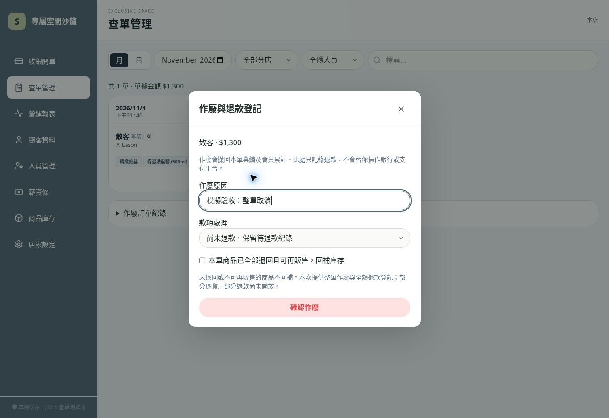

# v32.5 第二項：查單、改單、整單作廢與全額退款登記

唯一修改專案：jun051873-art/salon-pos-offline
原網址：https://jun051873-art.github.io/salon-pos-offline/

## 完成
- 改單、作廢、退款登記讀取最新本機資料，拒絕過期編輯或重複作廢／退款。
- 移除完整儲存後的重複分表寫入；儲存失敗保留原單、會員、庫存與編輯視窗。
- 改單需填原因，保留修改前日期、明細、金額、會員及付款方式，編輯視窗可展開修改紀錄。
- 原成本、抽成及協助費制度快照保留；舊單缺少 cartId 仍可對應原計算制度，未知快照不補算。
- 查單轉會員與訂單修正一起儲存，取消不留下新會員；阻擋重複電話。
- 作廢可選待退款／已實際全額退款／誤開未收款；零元不需退款。商品預設不回補，需確認全部退回可販售後才回補。
- 作廢紀錄顯示退款狀態；待退款可選實際退款方式登記一次，不再次回補庫存，不另建支出重複扣減。
- 庫存調整附訂單、商品及分店 ID，會員客次採 visitId 去重。
- 已確認薪資的人員與協助者月份不可直接改單或作廢；移入已確認薪資月份也會阻擋。
- 查單金額改標「單據金額」，避免修正後被誤認為已實際補收／退還。

## 測試
npm run build、npm test：38 項，37 通過，1 跳過，0 失敗。跳過私人備份測試，全程獨立模擬資料。
新增測試包括改價／折扣、移除商品庫存差額、會員累計、原計算規則、舊單識別碼、修改原因、過期編輯、重複明細、跨月、已確認薪資、協助者薪資鎖定、作廢退貨與不退貨、同次來店多單、會員轉換取消、儲存空間不足、重試及連點、退款金額與狀態損壞。

## 已發布頁面驗收（2026-11-04）
Chrome 桌面瀏覽器使用獨立模擬資料：服務 $600＋商品 $800 的單據，新增 $100 折扣後保存為 $1,300；整單作廢選待退款並確認商品退回，庫存由 9 回補為 10；登記轉帳全額退款後顯示「已全額退款」。重新整理後庫存 10、作廢原因與退款狀態仍存在，正常訂單為 0 筆。
這是桌面瀏覽器驗收，不代表 Android、iPhone 或 iPad 實機通過。

## 邊界
- 本輪是整單作廢及全額退款登記；沒有串接支付平台，不會自動退款。
- 部分退款、部分商品退貨、改價差額的收付款帳本、跨期退款現金流及完整損益仍待後續完成；本輪不宣稱第二項所有退款情境已完成。
- 編輯移除商品會回補庫存，只適用誤加或已退回可再販售的商品；未退貨減價請改價格／折扣。
- 作廢撤回原單營業額，退款只登記狀態，不再列支出。尚未退款不代表現金已流出。報表現有收支差額不是完整現金流／淨利。
- 舊作廢單無退款資料顯示「未核對」，不推定已退款。
- 手機／平板、Android 實機未完成驗收；本輪不做 AAB、不修改店用 pos222222 或其正式資料。

## 使用者驗收
用測試單：查單 → 編輯 → 改售價／折扣、填原因、保存 → 重開確認修改紀錄。
再用另一筆服務＋商品測試單：作廢 → 待退款 → 決定是否回補商品 → 保存 → 展開作廢訂單紀錄 → 登記已退款。
核對會員累計、商品庫存與退款狀態，重新整理應保留。
