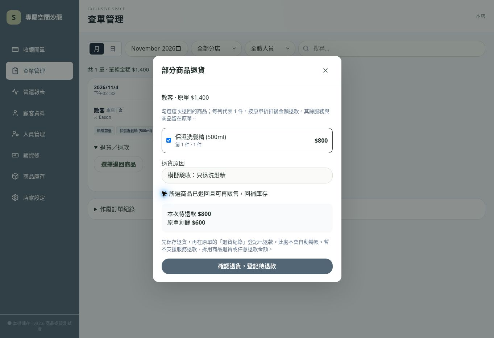

# v32.6 部分商品退貨測試版

唯一專案：jun051873-art/salon-pos-offline。店用版 pos222222 與正式資料完全不動。

## 本輪完成
- 查單卡片「退貨／退款」摺疊入口，可逐列選擇商品（每列 1 件）。退貨按原單折扣後金額，保留其他服務、商品及其原成本和抽成快照。
- 僅支援已退回、可再販售商品，確認後回補庫存、減少會員消費累計；剩餘訂單保留客次。
- 保存退貨先登記待退款，再從原單退貨紀錄登記實際退款方式。此操作不會自動退錢，不再重扣業績、不再回補庫存、不另建支出。
- 訂單、庫存、會員、退貨紀錄同一次寫入。過期視窗、重複提交、已確認薪資月份均阻擋。
- 已有退貨紀錄的訂單暫時禁止一般改單；仍可退其他商品或作廢剩餘項目。作廢後仍能看到與結清先前商品退款。
- 退貨紀錄隨備份保存；匯入驗證金額、狀態、原單連結與已退商品不得仍列在原單。

## 驗證
npm run build 成功；npm test 共 43 項，42 通過，1 私人資料測試跳過，0 失敗。全部使用獨立模擬資料。
新增覆蓋：只退其中一件相同商品、折扣金額、原服務抽成快照不變、會員客次保留、退貨後作廢剩餘單、無效／重複選取、已確認薪資、商品被刪除、退款連結損壞、儲存空間不足、連點、重開保存。
尚未完成手機／平板／Android 實機驗收。

## 使用者測試（一次驗收一個情境）
1. 確認左下角 v32.6。商品庫存記下洗髮精原數量 N。
2. 收銀開單選設計師，加入剪髮 $600 與洗髮精 $800，散客暱稱填「部分退貨測試」。結帳收款→現金（模擬記帳，無需實際收款）。
3. 查單管理找到 $1,400 測試單→展開退貨／退款→選擇退回商品。
4. 勾選洗髮精，原因填「測試只退洗髮精」，勾選「所選商品已退回且可再販售，回補庫存」。核對待退款 $800、原單剩餘 $600。
5. 點「確認退貨，登記待退款」。原單應留下剪髮 $600，庫存回到 N。
6. 在同張原單的退貨／退款區塊點「登記商品退款」→選現金→確認已實際退款（測試登記）。顯示已退款 $800，庫存不再增加。
7. 重新整理後核對原單 $600、已退款 $800、庫存 N 仍保留。先留下測試紀錄供驗收，不再刪改。

## 尚未完成
- 服務退部分金額、拆用或無法再販售商品退貨、任意金額退款。
- 改價差額補收／退款帳本與完整跨期現金流報表。本版報表僅沿用調整後原單，不能把它當完整損益或現金流。
- 已退貨訂單一般改單目前阻擋，待差額帳本完成才開放。
- 全部項目都退回請使用整單作廢。

## 已發布網頁實測
2026-11-04，在 Chrome 桌面瀏覽器使用獨立模擬資料實測：$1,400 混合單選洗髮精退回，畫面預覽待退款 $800、原單剩餘 $600；保存後原單僅留下剪髮。登記現金退款後顯示已退款 $800，重新整理後庫存仍 10 瓶、原單 $600、退款紀錄保留。此結果不代表手機或 Android 實機驗收。

