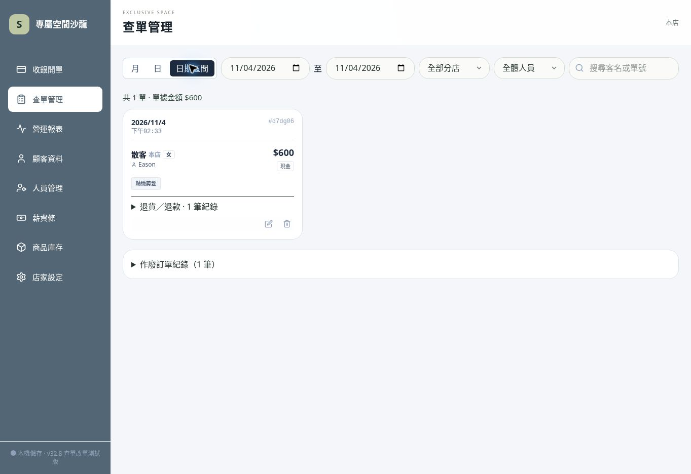

# v32.8 查單改單測試版

本次補上查單日期區間，正常訂單與作廢紀錄共用日期、人員（含共同服務／協助）、分店及客名／單號篩選。起訖反轉顯示提醒，不列出錯誤結果。作廢區塊維持收起並顯示筆數。
改單增加原金額→修正後金額與差額提示，明示尚未登記實際補收／退款。原有修改原因、歷史快照、會員與庫存連動、安全寫入仍保留。
本次沒有新增差額收退款帳本，不能把改價當作已退款；此限制仍待完善。

測試：npm run build；npm test 47 項、46 通過、1 私人資料跳過。新增跨月日期邊界、大小寫／空白搜尋、協助人員篩選、反轉區間、DOM 查單及不修改帳務測試。原改單庫存、會員、歷史抽成、寫入失敗／重試測試保留。

使用者驗收：另建會員「改單測試」和一張剪髮 $600 現金測試單，先用日期區間找出該單。按編輯→售價改 $500，填修改原因→核對原 $600／新 $500／減少 $100（尚未登記退款）→儲存。查單 $500、會員消費較修改前減 $100、客次不變、同期間服務業績減 $100。再次進編輯，展開修改紀錄，應有原因和修改前 $600。此為帳務更正模擬，不進行實際付款。

尚待完成：差額收退款帳本、服務部分退款與完整損益現金流；手機平板實機驗收。v32.7 退款報表使用者尚未回報通過。

線上 Chrome 桌面確認 v32.8 載入、日期區間按鈕與起訖欄位正常，原有模擬訂單 $600 與作廢紀錄 1 筆仍保留。手機與平板尚待使用者驗收。

